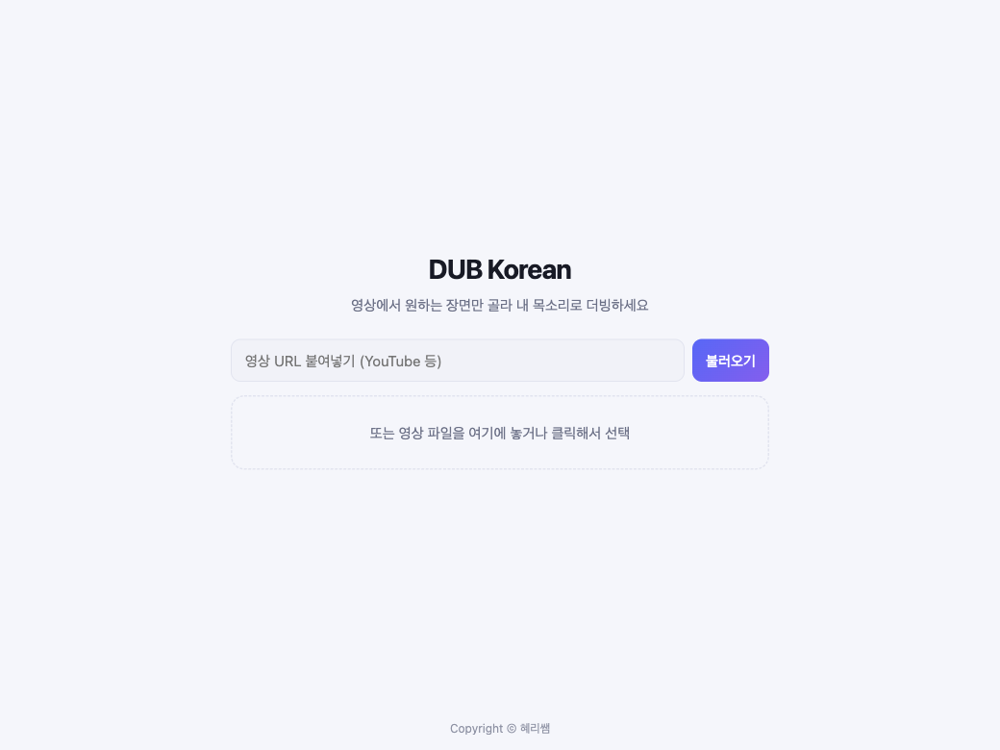
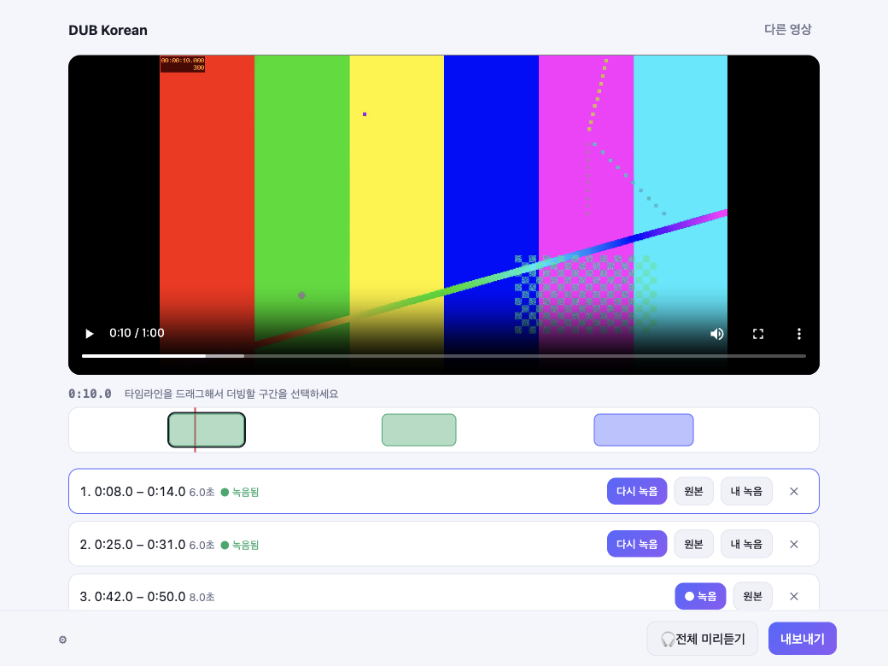
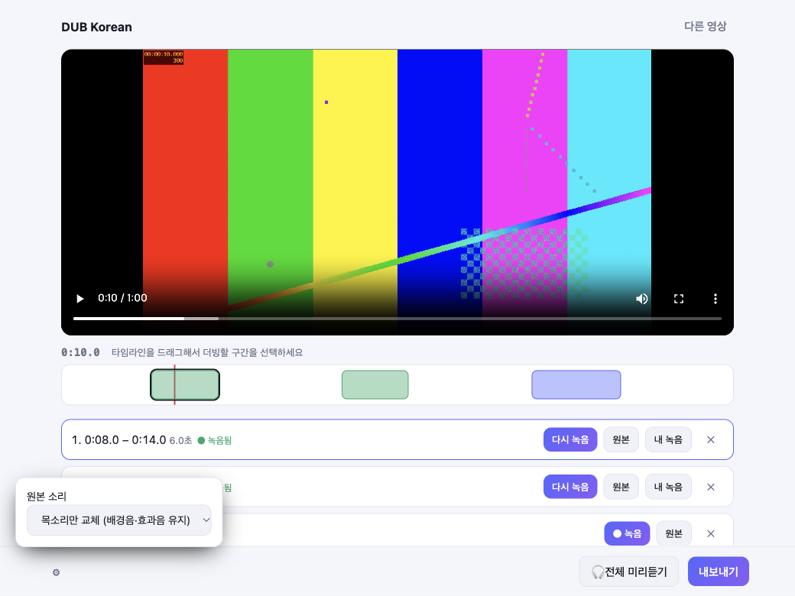
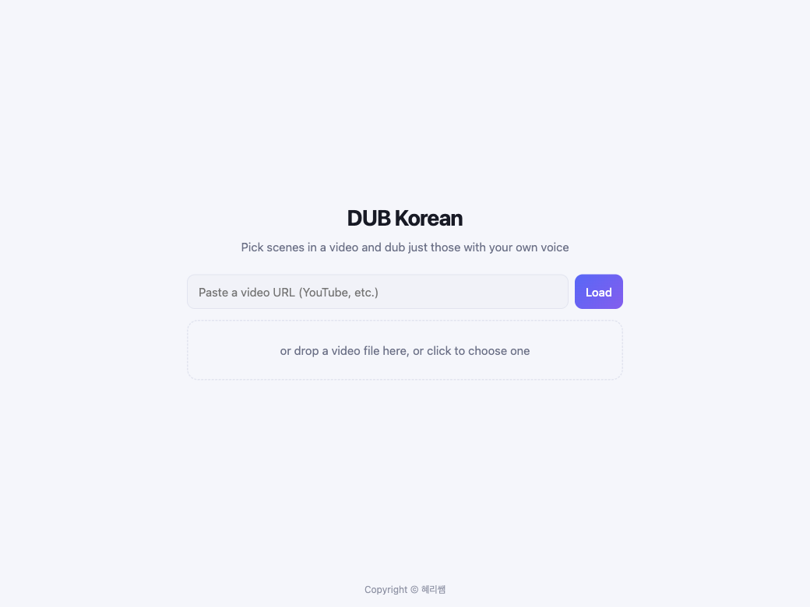
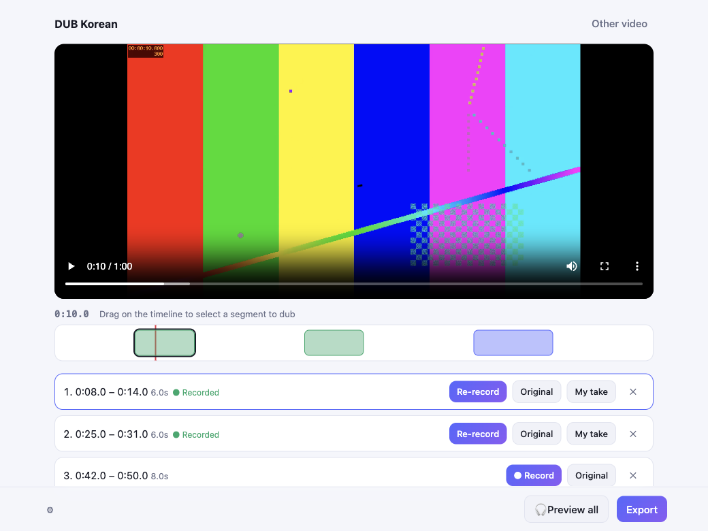
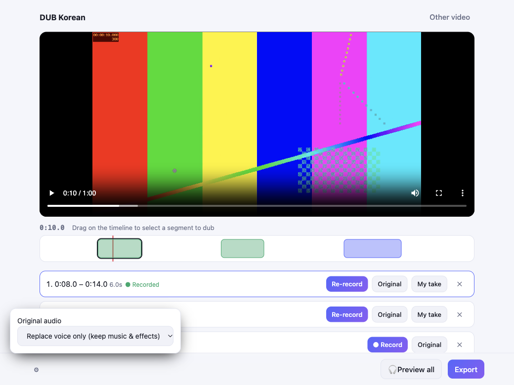

# DUB Korean

영상에서 **원하는 구간만 골라 내 목소리로 더빙**하는 데스크톱 앱입니다. (macOS · Windows)
*Pick segments of a video and dub just those with your own voice.* — [English guide ↓](#english)



Copyright © 혜리쌤

---

## 설치하기

1. 이 저장소의 **[Releases](../../releases)** 페이지에서 내 컴퓨터에 맞는 파일을 받습니다.

   | 컴퓨터 | 받을 파일 |
   |---|---|
   | Mac (Apple 칩: M1, M2, M3, M4 …) | `…mac-arm64.dmg` |
   | Mac (Intel) | `…mac-x64.dmg` |
   | Windows | `…win-x64.exe` |

   > Mac 종류 확인: 화면 왼쪽 위  메뉴 → **이 Mac에 관하여** → "칩"에 Apple이 보이면 Apple 칩, Intel이 보이면 Intel입니다.

2. **Mac**: 받은 `.dmg`를 열고 **DUB Korean**을 **Applications(응용 프로그램)** 폴더로 끌어다 놓습니다.
   **Windows**: 받은 `.exe`를 실행하고 안내를 따릅니다.

3. **처음 열 때 경고가 나올 수 있습니다.** 아직 Apple/Microsoft 인증서로 서명하지 않은 앱이라서 나오는 정상적인 경고입니다.

   - **Mac**: 앱을 **우클릭 → 열기 → 열기**. 그래도 막히면 **시스템 설정 → 개인정보 보호 및 보안**을 열고 아래쪽의 **"그래도 열기"**를 누릅니다.
     (터미널을 쓰신다면: `xattr -cr "/Applications/DUB Korean.app"`)
   - **Windows**: 파란 "Windows의 PC 보호" 창에서 **추가 정보 → 실행**.

## 처음 실행할 때

앱이 필요한 도구를 **인터넷에서 자동으로 내려받아 설치**합니다. 화면 오른쪽 위에 진행 상황이 나옵니다.

| 구성요소 | 용도 | 크기 |
|---|---|---|
| URL 다운로드 도구 | YouTube 등 링크로 영상 불러오기 | 작음 |
| YouTube 도우미 | 위 도구가 YouTube를 읽을 때 사용 | 작음 |
| 목소리 분리 (Demucs) | 배경음악·효과음은 두고 **목소리만** 교체 | 약 1GB (수 분) |

- Demucs를 받는 동안에도 다른 기능은 그대로 쓸 수 있습니다. 끝나면 "목소리만 교체" 옵션이 자동으로 켜집니다.
- 처음 녹음할 때 **마이크 사용 허용** 창이 뜨면 **허용**을 눌러 주세요.
- 한 번 설치되면 다시 받지 않습니다.

## 사용 방법



**1. 영상 불러오기**
영상 **URL을 붙여넣고 [불러오기]**를 누르거나, **영상 파일을 끌어다 놓거나 클릭해서 선택**합니다.
전에 하던 작업은 시작 화면 아래 **최근 작업**에 남아 있어 누르면 이어서 할 수 있습니다. (구간과 녹음이 자동 저장됩니다.)

**2. 더빙할 구간 고르기**
타임라인(영상 아래 막대)을 **드래그**하면 구간이 만들어집니다. 여러 구간을 만들 수 있고, 구간 목록에서 ✕로 지울 수 있습니다.

**3. 녹음하기**
구간 옆 **[● 녹음]**을 누르면 3초 카운트다운 뒤 영상이 재생되고(원본 소리는 꺼짐) 마이크가 녹음됩니다. 구간이 끝나면 **자동으로 멈춥니다.** 중간에 끝내려면 **[■ 중지]**.
- 녹음이 끝나면 아래에 **길이와 소리 크기**가 나옵니다. "거의 무음"이라고 나오면 마이크 권한을 확인하세요.
- **[내 녹음]**으로 들어 보고, 마음에 안 들면 **[다시 녹음]**.
- **[원본]**은 그 구간의 원래 소리를 들려줍니다.

**4. 전체 미리듣기**
**[🎧 전체 미리듣기]**를 누르면 처음부터 재생하면서 녹음한 구간에서만 내 목소리가 나옵니다.

**5. 내보내기**
**[내보내기]**를 누르면 선택하고 **녹음한 구간만** 더빙한 영상(mp4)이 만들어집니다. 나머지 구간은 원본 그대로입니다.
왼쪽 아래 **⚙︎**에서 원본 소리 처리 방식을 고를 수 있습니다.



| 옵션 | 설명 |
|---|---|
| 목소리만 교체 (기본) | 배경음악·효과음은 그대로 두고 원래 목소리만 내 목소리로 바꿉니다. Demucs 설치 후 사용 가능 |
| 구간 전체 끄기 | 더빙 구간의 원본 소리를 모두 끄고 내 목소리만 남깁니다. |
| 구간 전체 작게 | 원본을 작게 깔고 내 목소리를 얹습니다. |

완성된 영상은 **동영상 폴더 → `DUB Korean`** 에 저장됩니다.
(Mac: `~/Movies/DUB Korean`, Windows: `내 PC\동영상\DUB Korean`)

## 잘 되게 하는 팁

- **이어폰**을 쓰고 **조용한 곳**에서 녹음하세요.
- 구간은 **말이 시작하는 곳부터 끝나는 곳까지** 여유 있게 잡으면 자연스럽습니다.
- URL로 불러온 영상에 자막이 있으면 화면 위쪽에서 **자막 보기**를 켤 수 있습니다. (편집 중 참고용이며 내보낸 영상에는 들어가지 않습니다.)
- 앱 언어는 컴퓨터의 **시스템 언어**를 따릅니다. (한국어가 1순위면 한국어, 아니면 영어)

## 문제 해결

| 증상 | 해결 |
|---|---|
| 녹음이 "거의 무음"이라고 나옴 | **Mac**: 시스템 설정 → 개인정보 보호 및 보안 → **마이크** → DUB Korean 켜기 → 앱 다시 실행. **Windows**: 설정 → 개인 정보 → **마이크** → 앱의 마이크 액세스 허용. 입력 장치(이어폰 마이크 등)도 확인하세요. |
| "목소리만 교체"를 고를 수 없음 | 오른쪽 위에서 Demucs 설치가 끝났는지 확인하세요. 오류면 **[다시 시도]**. 인터넷 연결이 필요합니다. |
| URL로 영상이 안 불러와짐 | 링크를 확인하고 잠시 후 다시 시도하세요. 비공개·지역 제한·연령 제한 영상은 받을 수 없습니다. 안 되면 영상 파일을 직접 받아 파일로 여세요. |
| 처음 열 때 "확인되지 않은 개발자" | 위 **설치하기 3번**을 보세요. |
| 앱이 켜지지 않음 | 앱을 완전히 종료하고 다시 실행해 보세요. 계속되면 [Issues](../../issues)에 알려 주세요. |

## 개인정보와 이용 시 주의

- 영상 편집, 녹음, 목소리 분리, 내보내기는 모두 **내 컴퓨터 안에서** 처리됩니다. 영상이나 녹음이 외부 서버로 올라가지 않습니다.
- 인터넷은 **도구를 내려받을 때**와 **URL 영상을 받을 때**만 사용합니다.
- **본인이 권리를 가졌거나 사용을 허락받은 영상**에만 쓰세요. 다른 사람의 영상을 내려받거나 배포하는 것은 저작권과 각 사이트의 약관에 어긋날 수 있습니다.

---

## 개발자용

```bash
npm install
npm start             # 앱 실행
node tests/e2e.js     # 가짜 마이크로 녹음 → 미리듣기 → 내보내기 자동 테스트
npm run dist:mac      # dmg 빌드 (dist/)
```

배포: `v*` 태그를 푸시하면 GitHub Actions가 macOS(Apple 칩/Intel)·Windows 설치 파일을 빌드해 Release에 올립니다.

```bash
git tag v0.1.1 && git push origin v0.1.1
```

---

<a id="english"></a>

# English guide

**DUB Korean** lets you pick segments of a video and dub just those with your own voice (macOS · Windows).



## Install

1. Download the right file from **[Releases](../../releases)**: `…mac-arm64.dmg` (Apple silicon), `…mac-x64.dmg` (Intel Mac), or `…win-x64.exe` (Windows).
2. **Mac**: open the `.dmg` and drag **DUB Korean** into **Applications**. **Windows**: run the `.exe`.
3. The app is not code-signed yet, so you may see a warning the first time.
   - **Mac**: right-click the app → **Open** → **Open**. If it is still blocked: System Settings → Privacy & Security → **Open Anyway** (or `xattr -cr "/Applications/DUB Korean.app"`).
   - **Windows**: **More info → Run anyway**.

## First launch

The app downloads what it needs automatically (progress is shown at the top right): a URL download tool, a YouTube helper, and **Demucs** (about 1 GB, for replacing only the voice while keeping music and effects). You can keep using the app while Demucs installs. Allow the **microphone** when asked.

## How to use



1. **Load a video**: paste a URL and click **Load**, or drop/choose a video file. Past work appears under **Recent projects** (segments and recordings are saved automatically).
2. **Select segments**: drag on the timeline. You can make as many as you like.
3. **Record**: click **● Record** next to a segment. After a 3-second countdown the video plays (original sound muted) and your microphone records; it stops at the end of the segment. Use **My take** to listen, **Re-record** to redo, **Original** to hear the original.
4. **Preview all**: plays from the start, with your voice only in the recorded segments.
5. **Export**: click **Export**. Only the segments you recorded are dubbed; everything else stays original. The mp4 is saved to **Movies/DUB Korean** (Mac) or **Videos\DUB Korean** (Windows).



**Original audio** (⚙︎): *Replace voice only* keeps music and effects (needs Demucs) · *Mute whole segment* · *Lower whole segment*.

## Troubleshooting

- **"Almost silent" recording**: allow the microphone for the app (Mac: System Settings → Privacy & Security → Microphone; Windows: Settings → Privacy → Microphone) and check your input device.
- **"Replace voice only" is greyed out**: Demucs is still installing (or failed — click **Retry**). An internet connection is required.
- **URL won't load**: private, region-locked or age-restricted videos can't be downloaded. Open a video file instead.

## Privacy and fair use

Editing, recording, voice separation and export all happen **on your computer**. The internet is used only to download the tools and URL videos. Use it only with videos you own or have permission to use.
